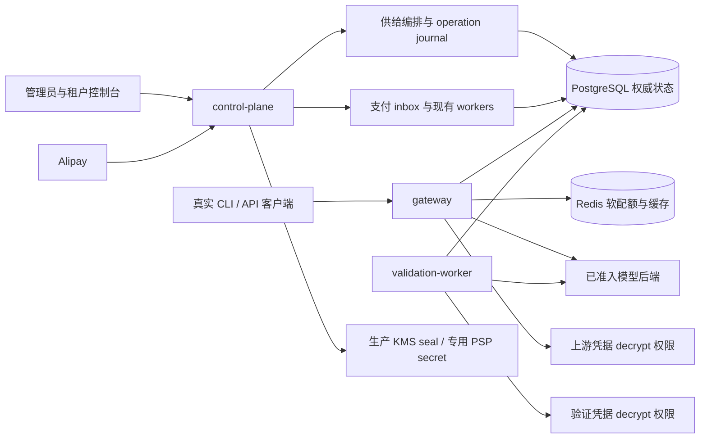

# 可运营多租户模型 API 平台：P0 技术方案

> 日期：2026-10-24。状态：实施中；历史工程基线`87cc8b4154e8b0edacf35b605ae38d9e434cc5ee`的自动CI #162为68/68 success，仅覆盖该revision。用户授权的一次PG故障run05已使用一次fresh build（791 src/3160 dist/13 harness）执行自然600s恢复，但canonical replay全authority比较失败，完整profile未通过。纯诊断补丁`4858757`及A0凭据隔离`5743b9c`已分任务推送；核心补丁`1c963b9`已过两路Astra源码审查和server构建；自动CI离线层36个独立失败已同步fixture，目标138/138与scoped strict通过，真实A0在CP启动阶段失败且未调用供应商。用户已后续明确允许按需执行所有验证，下一次PG待新冻结批次后执行；M1/M2/M3仍开放。
> 初始设计基线：model-router `44b0eb7`；Codex C1–C4 基础 checkpoint `f61afec`，后续改动按独立任务继续交付；只读对标基线：CLIProxyAPI `911f49c`、Sub2API `a3eb7ef`、New API `6549a17`。
> “拟新增”保留初始设计语境；当前实现与证据以各节明确状态及开发进度 §29 为准，源码交付不等同运营可用。
> 状态区分已实现、定向验证、待验收、外部证据阻塞；工程候选87完整CI已取得，真实 A0/Kimi、PSP、Codex 后端与生产恢复证据仍未齐备。

## 1. 目标、范围与交付边界

目标是让一个全新租户通过正式入口获得可授权、可计费、可撤销的模型供给，完成真实收款和退款，并在受控负载、故障和恢复后保持资金及请求证据一致。
以三个主线收口：A 标准供给与协议工作流；B 单 PSP 标准收款退款；C 托管性能、恢复和生产运维验收。
继续采用模块化单体，同一代码库按 control-plane、gateway、validation-worker 角色部署；支付与退款 worker 复用当前编排，不拆新微服务。
复用 tenant/project/Key、钱包、套餐、价格、供给池、商业策略、OAuth、账户刷新与已有恢复机制。
不扩展营销、插件市场、白标、多 PSP 路由、实时汇率、全新账户体系或无关多模态产品。

首发拟定 Alipay precreate + CNY，前提是获得实际商户配置和验收账户；当前没有商户证据不等于已经具备收款条件。
可先用经过证明的非 Codex text/function 供给进行选定范围演示与运营验收。
这不会移除完整 P0 中 Codex compact、WS、remote history 与可信计费上界的任务。

| 里程碑 | 可作出的声明 | 必须满足 | 当前状态 |
|---|---|---|---|
| M1 选定供给演示 | 新租户正式入口完成指定模型请求 | A 正式 provision、指定协议工作流、明示限制 | 关键代码与定向/PG18 验证已推进；正式指定供给全链待验收 |
| M2 可收费运营 GO | 经批准的供给、币种、商户范围可收费 | M1 + B + C 性能/恢复 + 生产 KMS/同步持久恢复 + 发布候选必需 CI + 运营签收 | 未关闭；工程候选87 CI通过，真实 PSP、R9、生产 KMS/恢复待证据 |
| M3 全 P0 完成 | 本方案关键能力全部收口 | M2 + 完整协议矩阵 + Codex 外部契约与真实工作流证据 | 专项回归、完整协议/真实工作流及外部证据待验，未关闭 |

M2 必须公示供给与工作流 allowlist，不能宣传已完整对齐 Codex compact/WS。
不能通过缩小全 P0 的定义，把 M1 或 M2 改称 M3。

## 2. 初始设计基线与六个真实缺口

以下保留初始设计基线的缺口与源锚点，不能作为本轮实施后的现状判断；当前进展见§4/§8及开发进度§29。锚点相对仓库根目录，行号对应设计时版本附近实现。
对标关注 CLIProxyAPI 的 provider/协议工作流、Sub2API 的运营供给闭环、New API 的通道/价格/支付运营闭环；不按页面或 provider 数量机械复制。

| 缺口 | 初始实现与源锚点 | P0 收口 |
|---|---|---|
| G1 新租户平台权益没有正式供给闭环 | `src/saas/identity/service.ts:1156` 仅创建 tenant/default project/owner；`src/saas/keys/service.ts:541` 无权益报 `KEY_NO_ENTITLEMENT` | 窄 provisioning service 与管理员操作入口 |
| G2 协议可达性与 CLI 工作流证据不完整 | `src/protocol/bridge.ts:317` 缺 Chat↔Gemini、Responses↔Gemini 四方向；`src/saas/runtime/builtin-gateway-runtime.ts:595` 默认拒绝单 native 供给跨协议，Kimi/OpenAI 为例外 | 按 operation/protocol pair/workflow profile 开放，直接桥与真实 CLI 证据 |
| G3 Codex 计费边界不能证明 | `src/saas/runtime/builtin-usage-bounds.ts:149`、`:174` 与 runtime `:713` 明确 unavailable | 可信上界契约及后端证据；缺证继续拒绝 |
| G4 PSP 代码存在但正式装配和收银台未闭合 | 四个 provider 已有；CLI `:407` 只处理环境，`src/server/managed-saas.ts:476`、`:2669`、`:2909` 需要 payments/refundAdapter 装配；`saas-wallet.tsx:691` 仍为文本 | 单 Alipay 配置装配、二维码、轮询、退款状态 |
| G5 商户版本与历史单生命周期未闭合 | orders/refunds 有 provider_key/merchant_id，当前 singleton 会按当前 merchant 拒绝历史单 | immutable binding、历史 verifier/adapter 与单队列分派 |
| G6 SaaS 性能与收费生产恢复未验收 | 已有 Redis 配额/异步日志；短诊断 overhead 797.59/207.23ms 仍超过 30/10ms；软件 KMS pilot-only | 保留原 R9、正式供给首请求、故障不变量、生产 KMS 与异地恢复回执 |

`src/saas/plans/service.ts:1784`、`:2047` 的 project entitlement INSERT 是 BYOK 路径。
平台供给示例来自 `verify-commercial-kimi.ts:793`、`:796` 的 seed，不是新租户正式开户验收。
平台 catalog 主要负责读取；`src/saas/supply/service.ts:2500` 已有 grant，要求 profile active。
`src/saas/gateway/route-config-service.ts:348`、`commercial-metering-policy-service.ts:833` 与价格/capacity service 都应复用。
不能把上述能力描述为现成的单一 CLI 自动开通流程，也不能全部重建。

### 关键能力对齐映射

下表引用上述固定 revision 的参考源码能力，不构成对方线上可用性或性能验收声明。

| 参考源码与能力 | 本项目任务 | 对齐出口与边界 |
|---|---|---|
| CLIProxyAPI [账号池调度](/Users/lex/play/CLIProxyAPI/sdk/cliproxy/service_config.go:65)、[生产自动刷新启动](/Users/lex/play/CLIProxyAPI/sdk/cliproxy/service_lifecycle.go:102) | P01/P03，复用既有 OAuth/sink/refresh | 首发 pool 正式开户与可用性；不承诺复制 RR/WRR/fill-first/session affinity 全部策略或所有 provider，不扩新策略工程 |
| CLIProxyAPI [CLI/Responses WS 路由](/Users/lex/play/CLIProxyAPI/internal/api/server_routes.go:72)、[Vertex compact 限制](/Users/lex/play/CLIProxyAPI/internal/runtime/executor/gemini_vertex_executor.go:269) | P04/P05 | route 存在不等于所有 provider 通用或可信计费；该 executor 明确不支持 compact，Codex 缺证继续拒绝 |
| Sub2API [支付路由](/Users/lex/play/sub2api/backend/internal/server/routes/payment.go:32)、[余额/套餐履约](/Users/lex/play/sub2api/backend/internal/service/payment_fulfillment.go:216) | P06–P08 | 对齐回调、余额或套餐履约和退款用户交互；限定单 Alipay/CNY 真实扫码、到账、退款，不以多 PSP 数量冒充闭环 |
| Sub2API [PG 备份实现](/Users/lex/play/sub2api/backend/internal/repository/backup_pg_dumper.go:35)、[备份操作界面](/Users/lex/play/sub2api/frontend/src/views/admin/BackupView.vue:860) | P10–P12 | 目标是实际恢复工作流；按钮或 pg_dump 成功不证明异地恢复、金融保证或 RPO |
| New API [多协议路由](/Users/lex/play/new-api/router/relay-router.go:78)、[统一预扣/结算/退款会话](/Users/lex/play/new-api/service/billing_session.go:47) | P04/P05/P07/P09/P10 | 对齐多协议、WS 逐事件准入与资金生命周期；复用现有财务，不重建，接口覆盖不代替真实 CLI 和计费上下界证据 |

不按 provider 或页面数量全量复制参考项目。

## 3. 架构与权威边界



PG 保持账本、余额/hold、累计 Key/计费组预算、派发证据、支付事实与 operation 权威。
Redis 已承担共享 RPM/TPM/并发软配额；异步日志是独立写入机制，约 5 秒成功 auth cache 是进程内缓存。
三者均为已有机制，不列为待重建功能，也不把日志或 auth cache 归为 Redis 持久性保证。
非金融 Redis 计数存在已接受的短暂丢失窗口，不能宣传其 RPO=0，也不能把资金安全建立在异步 Redis 上。
control-plane 只读取 PSP 专用 secret，不新增上游凭据 decrypt 权限；gateway 不接收支付密钥。
validation-worker 保持当前账户验证职责，不能因支付接入扩大其权限。

## 4. A 轨：正式平台供给入口

### 4.1 窄服务与最小 API（本轮实现）

`PlatformInferenceAccessProvisioningService` 协调已有 pool、route、commercial policy 与 capacity services；不新增 offer/recipe 市场。实际 DTO 以 `src/saas/supply/platform-inference-access-provisioning.ts` 为准，版本字段全部为 decimal string：

```ts
type ProvisionPlatformInferenceAccessInput = {
  operationKey: string;
  tenantId: string;
  projectId: string;
  pool: { id: string; expectedAuthzVersion: string; evidenceReference: string; evidenceSha256: string; expiresAt?: string | Date };
  capacity: {
    tenantExpectedRevision: string;
    projectExpectedRevision: string;
    tenantLimits?: CapacityPolicyLimits;
    projectLimits: CapacityPolicyLimits;
  };
  routes: Array<{
    routeId: string;
    definition: RouteConfigDefinition;
    customerPolicy: { policyId: string; definition: CustomerMeteringPolicyDefinition };
    providerPolicy: { policyId: string; definition: ProviderMeteringPolicyDefinition };
    attestation: Omit<ContractTestAttestationInput, 'tenantId' | 'projectId' | 'audit'>;
  }>;
};
```

`projectExpectedRevision` 比较真实 `saas_projects.inference_policy_version`，不存在 `expectedProjectAuthzVersion` 字段。路由输入沿用 `RouteConfigDefinition`，新 profile 的 route version 由操作创建并记录。嵌套 DTO 严格解析，tenant/project/audit 只能由服务端身份注入。商业 attestation 的独立公钥与 suite test-vector digest 信任配置缺失时不能准入。

Codex 开户新增服务端 `admissionReadiness`：从已核验 route/provider policy 导出精确 HTTP/full scope，在创建前和最终激活前检查 reviewed profile；缺端口或空 registry 返回 `TRUSTED_USAGE_BOUNDS_UNAVAILABLE`，不激活权益。这只证明选定 scope 的静态财务条件，不代表任意 payload、WS/compact、动态健康或真实工作流可用。

现有管理员 router 前缀为 `/admin/api/v1`：`POST /supply/platform-access/operations` 创建或续做操作，`GET /supply/platform-access/operations/:id` 查询，`POST /supply/platform-access/disable` 携带 `operationId/expectedEntitlementVersion/reason`。使用已有管理员鉴权、CSRF 与审计链；不返回凭据。同 operationKey 同摘要返回原操作，不同摘要冲突。tenant/project 跨界、未发布价格、币种、能力及证据期限均须核验。

### 4.2 持久阶段与失败恢复（本轮实现，待验收）

operation journal 实际阶段为 `assembling/recheck/completed/failed/disabled`，与 entitlement `active/disabled` 独立。journal 保存 actor、摘要、资源 refs、阶段 receipts、runner 和错误码；既有子服务各自提交事务，整体不是单一原子事务。

1. 固定 G→tenant→project→actor 授权锁顺序，拒绝已有 active 平台权益的隐式替换。
2. 短事务先创建 operation 专属 active profile，再创建 disabled entitlement（带 disabled_at），同时写 journal/资源关联及 profile、entitlement 审计；满足 schema005 即时 FK。
3. 贯穿本次 run 的独立 operation advisory guard 防止在途执行与接管竞态；子服务独立事务，不跨子调用持有 authority/row 锁。control-plane pool 至少两个连接。runner_until 仅诊断，不作为自动接管依据。
4. 幂等执行 pool grant、route 和 customer/provider policy create1/publish2、signed v2 attestation、bind、capacity，逐步记录 receipts。失败保留 journal，不删其他操作资源。
5. 最终重新检查 route.resolve、commercial authority、价格/币种/有效期、每条 route 的 pool provider/product 与 capability/credential/rights、tenant/project capacity revisions。
6. 若 project inference policy 原为 suspended，追加 next active policy，复制原三项限额并 CAS 当前 `inference_policy_version`；与 entitlement active/authz+1、审计和 operation completed 在同事务提交。版本或授权变化不得完成。
7. cancel/disable 仅作用于该 operation 权益，不 suspend 共享 project、不影响既有 BYOK。warm cached-auth下tenant/Key/entitlement撤销的inference HTTP补证已完成：fresh PG18 commercial run03共30/30，三类撤销在两实例warm cache下全部返回typed403。源码无reload、无主动cache clear；真实prelock2/11表零变、resume B与版本审计均验证，依靠PG权威fail-closed，不声称其他实例的进程内Map cache被清除，亦未新增fence竞态。

不自动发 Key 或充值；余额与 Key 仍走已有明确入口。显式替换旧权益需独立展示影响并授权，初版可拒绝。以上是本轮代码合同，不表示 PG 并发、受限角色、真实供给或正式 provision 工作流已经验收。

### 4.3 协议准入与 CLI 工作流

provider adapter、OAuth、sink、refresh、WS、compact 已有接线，P0 补齐准入及证据，不另造 provider 框架。
复用 capability/readiness，索引维度必须是 operation + client protocol + upstream protocol + workflow profile。
先开放已有并通过证据的 pair，再实现四个直接桥；禁止随意串两段有损 SSE 转换充当直接支持。
遇到不支持的供应商特有字段，应返回明确错误及字段说明，不静默删除 thinking、tool 或 continuation 语义。

| 工作流 | P0 实现/证明内容 | 出口与状态 |
|---|---|---|
| Chat↔Gemini | 请求、工具、usage、流式增量、错误和取消的直接转换 | 已实现；计入全bridge56/56定向验证；真实CLI待验 |
| Responses↔Gemini | response/item/tool IDs、状态、usage 和流式事件直接映射 | 已实现；计入全bridge56/56定向验证；真实CLI待验 |
| 现有 Anthropic/OpenAI/Responses pairs | 旧Gemini↔Anth P1已修；审视capability与runtime默认拒绝 | 全bridge56/56、`9b14151`已推送；未因注册自动放开供给 |
| 真实 CLI 两轮工具调用 | 实际 CLI 版本、精确模型、两轮 tool result、thinking 保真/限制、取消、重连、usage | 待验收 |
| Codex compact/WS/remote history | endpoint/model/backend revision、完整 billable input 和 reasoning output 上界 | 代码/本地TLS/PG18分层验证；真实计量契约外部阻塞 |

每条矩阵记录 CLI 名称/版本、operation、pair、模型 revision、输入类别、流式/非流式、证据 ID 和限制。
“HTTP 200”不足以证明两轮工具或 compact 工作流成功；需保留脱敏事件序列和最终账务快照。
重连不能默认重放已派发请求；沿用现有幂等/unknown 语义，按操作契约处理。

### 4.4 Codex 托管工作流与可信计费上界

完整目标保留 native HTTP、WS、compact 和 remote history；不能用诊断就绪或单个 SSE 成功替代完整托管验收。
当前供给是 `codex-chatgpt` / `chatgpt.com/backend-api/codex`。它与官方 `api.openai.com/v1` SIWC 是不同契约；SIWC preview 对 `max_output_tokens`、HTTP `previous_response_id` 的限制不能外推为本后端支持或 enforcement 证据。

| 范围 | 当前实现事实 | 完成门槛 / 依赖 |
| --- | --- | --- |
| HTTP `/responses` 完整上下文 | 已有专用 OAuth HTTP transport 和 SSE usage observer；本轮修复终态完整性 | endpoint/model/backend revision 的完整输入、reasoning 和输出上界证据；真实 CLI 工作流 |
| 客户端 `/v1/responses` WS full | 逐轮 preparation/admission/dispatch/settlement；本轮新增 fixed-wss native adapter、opaque session 与专用 scope，raw JSON 转 SSE 复用原结算链 | native adapter 逻辑/装配与真实后端 workflow 分开；须受限角色、连接断开、两轮工具及精确端点/契约独立验收 |
| WS `previous_response_id` continuation | 持久部署在 preparation 前逐引用执行 durable resolve，绑定 tenant/project/key/conversation/provider/account/credential versions/public+resolved model；同代 native 引用仍独立校验 | 消费端24/24通过，含跨连接恢复/身份变化补偿/TTL删除；真实CLI/后端及标准部署全链待验 |
| `/responses/compact` | 已有独立 HTTP passthrough；整份 `output` 都属于后续上下文 | compact 真实 CLI 请求、加密项和普通输出完整回放、compact 单独 trusted profile |
| HTTP remote history / 重连 | HTTP实际消费端10/10、WS消费端24/24与服务端编译通过，统一identity/namespace；`72b7b97`已推送 | 真实后端、多实例/KMS及标准部署恢复验收 |

C1：execution status 与 usage completeness 独立。`response.completed/incomplete/failed` 的终态 usage 都保留；缺失 input/output 不补成零，显式零仍可报告。重复冲突终态、坏帧、截断及超限不得形成 complete evidence。usage 不完整保留 unknown/reconciliation 路径。客户端协议 bridge 的结束状态与用量映射也覆盖 incomplete/failed；待针对测试与真实失败流验收。

后续源码审计发现`ResponsesUsageWatcher.feed`只检查解析后的残余buffer，完整超大事件可在同一chunk内先被解析并清空，绕过1MiB上限。现每个完整事件在JSON解析前按UTF-8字节限长，残余片段使用相同字节上限；分隔符不计入正文，同chunk多个各自合法事件不按总量拒绝。超限保留sticky invalid，后续合法终态不能恢复complete usage。修复已随`7718c49`交付，Astra实际差分复核通过；历史#161及当前候选87的自动CI均68/68成功，仅只读收集结果，没有本地新验证或新增专项用例。新的逐事件字节边界规格专项回归与真实失败流验收仍开放，详见进度§29.43/§29.45。

C2：`previous_response_id` 不是普通可丢弃字段。WS 在编译、签名和预留前构造完整 canonical request，保存完整 `response.output`，包括 compact 普通输出与加密项；transform 对未解析 HTTP reference 显式拒绝。native WS 仅在服务端确认同一 socket generation 的已完成 ID 后签 remote-history 请求，并保留 canonical tools/instructions，仅发送本轮 input；否则使用已验证 canonical replay 或返回409。持久 namespace 只取显式 `conversation_id` header/body（均有时必须一致），不用 WS 随机 session ID；缺 namespace 可执行完整请求但不存，引用请求则409。配置 resolver 后每次引用均 durable lookup，不用本地明文 cache 绕过 TTL/删除；prepare 后完整 identity 不符先补偿再409。仅金融 `settlementOutcome==='settled'` 后保存；replayed 可能仍 reconciliation_pending，不作为保存凭据；写失败不撤销已发生计费。

持久 DTO 为 `responses-continuation-history.ts`：tenant/project/key/conversation/response scoped reference，provider/product/account/credential id+version+authz version/public+resolved model 完整绑定，canonical digest 和 expiry 纳入 AEAD associated data；PG 仅存 ciphertext envelope 与 key id，复合 tenant/project/key FK，禁止用户上下文明文进入数据库或日志。数据库时间 TTL、有界清理、tenant/key 回收和 immutable insert conflict 均是验收要求。迁移141、PG adapter、AEAD cipher、resolver 已实现，真实 PG18.6 受限 gateway history1/1通过；WS实际消费端24/24覆盖新连接恢复、scope隔离、身份补偿、pending/replayed拒存、写失败与长连接TTL/删除。HTTP实际消费端10/10包含按实际Content-Type捕获与finish/abort边界，服务端编译通过，消费端交付已随`72b7b97`推送。真实后端、多实例/KMS与标准部署恢复仍待验，不能由本地消费端结果外推生产全链。

C3：`max_output_tokens` 被保留不证明后端强制执行。新增代码审阅的 trusted-bound registry，默认空，无 operator JSON 注册信任入口。profile 精确绑定 endpoint、product、model、operation、实际上游 transport、continuation mode、backend revision、evidence version/reference、完整 billable bounds 与有效期。完整 profile canonical SHA-256 与 compiler version 生成47字符 `cb1:`内容寻址版本，复用现有 signed `payloadCompilerVersion` 和 request fingerprint version，避免越过 metering 64字符限制。每次实际 send（包括重试、HTTP/WS逐轮、compact）在 credential 使用前对 proof/evidence 与实际 scope 重验，过期/撤销/旧version均拒绝。当前没有任何已接纳的 ChatGPT 后端证据，保持 hard reject，代码实现不代表财务准入完成。

后续源码审计发现builtin准入以`builtin-gateway-payload/v1`生成cb1，而发送重验误用通用`provider-payload-compiler/v1`，合法profile也会出现版本不匹配；空registry使这条问题路径暂未运行。现以无依赖叶子`builtin-payload-compiler-version.ts`共享原builtin版本，准入与发送使用同一常量；通用compiler默认版本、cb1算法、proof/精确scope校验及空registry拒绝均不改。修复已随`92f477a`交付，Astra实际差分复核通过，当前候选87的自动CI已68/68成功；未添加专项用例，亦未进行本地新测试/构建。本地dist仍旧，合法真实reviewed profile的正向覆盖与实际后端验收没有新证据，详见进度§29.42/§29.45。

C4：readiness 分别记录 transport assembled、credential verified、financial admissible、workflow verified 四事实；HTTP full、WS full、WS continuation、compact 分行。HTTP mount 不能自动证明 WS mount，provider credential 验证不能自动证明 workflow live。native connector 使用 Undici 公共 WebSocket dispatcher 接现有 DNS pin/proxy/TLS 连接器；beta header `responses_websockets=2026-02-06` 来自 CLIProxyAPI 实现参考，不构成 ChatGPT 后端官方契约；应用层 frame/queue/timeout 有界，溢出关闭并保留 unknown，不宣称公共 API 支持 TCP read pause。workflow 只有独立 live evidence record 才为 true；空 trusted registry 财务项为 false。

C4精确覆盖已实现：不得用全局profile数量或固定unavailable占位推断四行财务就绪。候选范围取active catalog中精确`productId + resolved upstream model`，其中model来自`saas_public_model_versions.model`而非public alias；包括仍active的固定旧版本，不能只取最新public model版本。catalog `codex-responses`明确映射现有HTTP/WS物理端点；无法确定、空集或坏候选全部false，不从已有profile反推已部署模型。每行要求候选集合逐一全部覆盖：HTTP full、WS full分别匹配自身transport/mode；WS continuation同时要求canonical-replay与remote-history；compact单独匹配responses.compact/http/compact。同一次收集使用当前时间及现有resolver校验有效期/撤销，registry仍默认空。

此处仅表达明确catalog范围的静态财务覆盖，不证明任意composite route、tenant entitlement、价格或实际请求已准入。bundle整体按runtime原有声明的三项工作流及可选compact全部覆盖汇总，实际transport装配、credential verified和独立live workflow证据仍各自计算，不能互相抬升。真实send/provision继续精确scope检查，全局profile计数仅作展示。本轮已在四个runtime文件实现，Astra算法差分及独立schema/既有CP/GW列权限只读复核通过，无迁移/grant变更；仅同步既有collector fixture的第五次查询，未新增case、未进行本地运行。交付commit为`87cc8b4`，该确切工程候选的自动CI #162已68/68成功；这是只读收集既有自动CI，不是本地新验证。本地dist没有更新；新边界规格、合法profile对各workflow的正向覆盖、真实profile/多实例验收仍需额外专项回归和外部证据，详见进度§29.44–45。

C5：新开户只创建账户和明确 entitlement，不 seed 模型、余额、供给或可信 profile。演示与正式供给按单独 provision 合同执行，不能由 Codex 配置自证解锁。

当前证据：基础 Codex/continuation/profile 定向15/15、native及相关定向29/29和服务端编译通过；真实本地 TLS I/O 1/1验证固定 hostname/CA、两轮 socket 复用、SSE/terminal usage、写后断线不重发和连接清理。该本地测试用受控 connector DI，仅连接合成服务器，不代表生产 DNS/proxy 或真实 ChatGPT 后端。最终审查发现的 safe session error/public alias pin 两项P2已修，Luna 后续 helper/native TLS/transport/executor 定向25/25及服务端编译通过。

剩余顺序：①C1新字节边界规格及C3/C4合法profile正向覆盖的专项回归（需相应验证授权，不改空registry）；②标准部署、多实例/KMS与compact完整窗口验收；③真实后端native WS/逐轮恢复工作流；④供应商enforcement/完整计量合同；⑤精确endpoint/model/revision真实CLI验收并保存四事实证据。HTTP/WS消费入口工程已交付，最终native P2及WS TTL P2已有回归；registry仍空，外部计量契约缺失保持hard reject。部署集成验证与真实工作流各有独立出口，不能全部归为供应商阻塞。超过预留、revision变化或证据撤销时停止新admission，保留派发/结算证据进入人工对账。

## 5. B 轨：单 PSP 收款与退款

### 5.1 首发装配与配置（拟新增）

拟新增 `MODEL_ROUTER_SAAS_PAYMENTS_CONFIG_FILE`，仅 control-plane 读取。
配置 schema v1 的 provider 枚举只允许 Alipay；现有 Stripe/WxPay/EasyPay 代码继续保持明确未启用状态。
首发使用 Alipay precreate 返回的 QR 内容；当前联合类型适合该路径。
Stripe 当前把 client_secret 放入 qr，且没有 Stripe.js collector，因此不能作为首发默认方案。

配置包含 schemaVersion、bindingId、provider、merchant public identity、currency、状态和 secretRef。
状态为 `disabled/draining/enabled`：enabled 接新单；draining 拒绝新单但继续历史 callback/query/fulfill/refund。
disabled 不得无条件丢弃已存在支付事实；在历史义务未清理前应保持 draining，紧急停用需人工对账。
公有摘要和配置 hash 可以持久化；secret 只保存引用，不写配置导出、日志或 Git。
PSP 私钥/证书由 systemd credentials 或 compose 只读 secret mount 提供；失败启动应明确指出缺少引用，不打印秘密。
现有 CLI/environment 装配处必须把 provider 与 refundAdapter 实际注入 `managed-saas`。

### 5.2 商户 binding 与版本

拟新增 append-only merchant binding/version；同 provider 可有 active 新单 binding 和多个 draining 历史 binding。
merchant 身份包括 app/seller/merchant 标识及环境，创建后不可修改；切商户创建新 binding。
多 control-plane 副本的新单 active binding 由 PG 按 purpose/currency 作用域的 version/CAS 指针决定，复用已有 versioned platform setting/注册元数据。
JSON 中 activeMerchantVersion 只表达部署期望，不能由副本本地配置决定新单商户。
切换先确认相关副本都可解析新 binding 与历史 binding，再以 expectedVersion 执行带审计的 CAS 激活。
create-order 先复用 `findOrderByClientRequest` 按 tenant + 原业务幂等身份查既有订单及原 binding，再处理真正新单。
已有记录必须按原幂等指纹比较 payload，匹配则返回原单，不因商户切换重新计算指纹或找不到原单；不匹配返回冲突。
仅真正新单在同一事务读取并绑定 PG 权威 active generation；并发创建由既有唯一约束/幂等重读收口。
副本缺少该 version 时拒绝新单并报告 readiness，历史 callback/refund 继续。
订单、BYOK plan order、payment inbox、refund 持久化不可变 `binding_id`。
退款继承原单 binding，禁止使用新商户密钥退款旧商户订单。
私钥轮换独立建允许的 credential version 关系，保留凭据生效期、证书/公钥与审计，不等同于商户迁移。

callback path 仅定位候选 verifier，不构成身份事实。
通过验签后核对 app、seller、订单、金额、币种等真事实，再写入现有 inbox。
保持原去重身份，不因新 callback 入口或 binding 版本扩大可重放次数。
原单关联、provider 事件 ID/既有业务唯一约束继续防重复，验签成功也不能重复入账。
单队列 worker claim 后按原单 binding 选择 adapter，不为每个 merchant 启动一个抢全表的旧 worker。
query、fulfill、refund 与 reconciliation 同样按 immutable binding 查 adapter。
旧行只在唯一可证时回填；歧义进入明确 reconciliation 状态，禁止该商户启用新单直到解决。
不得凭“当前配置看起来一样”猜测历史 binding。

### 5.3 资金与币种不变量

钱包、套餐、PSP 与 customer price 必须同币种；CNY 收款不得默记 USD。
复用既有 append-only 发布 CNY 价格/计划，不引入实时 FX，不虚构一组新价格通过检查。
金额在服务内使用 BigInt，跨 JSON 边界用最小单位十进制字符串；禁止浮点乘除与前端换算权威金额。
BYOK customerPriceVersion 为 null，模型调用不扣平台 Token 钱包；BYOK 套餐支付仍遵守其订单币种。
浏览器成功页面不入账；以验签 PSP 事实及既有服务条件驱动账本变化。
支付重复、乱序、查询超时与提交 ACK 丢失只查原单，未知结果不能创建替代金融请求。
所有金融变化与审计在同 PG 事务提交；hold 和 unknown 保留到有证据或人工裁决。
退款上限、并发退款、重复 PSP 回执和到账后的套餐权益影响复用现有 refunds 机制。

### 5.4 收银台交付

钱包和套餐入口都需要本地 QR 渲染，不能继续只展示 textarea 或文本。
QR 内容必须来自服务端订单结果，浏览器不接触 PSP secret；二维码组件依赖在实现评审时选定。
页面显示币种、最小单位格式化金额、订单号、过期时间与明确状态。
复用已有客户订单查询接口轮询，包含退避、后台暂停、过期停止和恢复查询。
创建响应丢失且浏览器没有 orderId 时，不能调用只认 orderId 的现有 GET 猜测原单。
客户端使用原 POST + 原 idempotency-key + 原 payload 重入，服务端通过 `findOrderByClientRequest` 返回原单与原 binding，再按 orderId 查询。
明确关闭/过期后才允许用户显式创建新业务请求及新幂等键；不能因切商户或超时自动换键。
退款展示 submitted/processing/succeeded/failed/unknown 的现有语义映射及人工处理中提示。
只有服务端确认入账才刷新余额与权益；前端状态不得成为支付完成证据。

## 6. C 轨：性能、过载和故障恢复

### 6.1 先验证最小正式路径，再扩展压力

先用 A 正式 provision 的全新租户，通过非 seed 正式 admin/customer 入口及实际 builtin 完成首笔请求，禁止 direct SQL 代替开户。
canonical R9 使用标准 CLI 与 bench runtime/mock 固定夹具，功能及财务约束使用真 PG；它不是 builtin 真实 provider 验收。
标准开户/实际客户端工作流与 canonical R9 是两个独立 gate，分别保存证据。
最新短诊断 797.59ms p99 overhead、207.23ms TTFB overhead 仍未满足 30/10ms 原门槛。
self-hosted 真实 Kimi 交替请求与直连接近，只说明该次路径；不能代替 SaaS 托管验收。
已实现的 Redis 共享配额、异步日志和 auth cache 作为基线，不重复立项。

1. 专用 runner 固定 hardware、依赖版本、payload、build、durability 配置与供给，记录持续 CPU/load/IO。
2. 原受控 serial 四腿各 100 样本对照先执行；保留原 p99 overhead ≤30ms、TTFB overhead ≤10ms，不更换 percentile 算法消除尾部。
3. 同 binary、同资源比较 cap 关闭与 cap=8 的 c=200、60 秒 A/B；关闭用环境变量 unset/empty，禁止设为字面量 off；8 仅候选，不能预设为最终容量。
4. 前项有有效结论后执行原完整 R9：SSE 10 分钟、零意外 5xx/transport、1→3 实例 ratio ≥2.7、账户精度。
5. 每个主要负载至少保留 100 个成功样本，作为拟新增样本充分性门槛；不足记不充分，不能宣告通过。

分开报告 HTTP 200 请求的 accepted latency、HTTP 200 successful rps 与 HTTP 429 数量/比例；这里的200是状态码，不是最低200rps吞吐门槛。保留失败原样本，R9 ratio>=2.7与c=200等既有门槛不变。
cap=8 不能仅通过拒绝大部分请求改善表面延迟；必须解释成功吞吐和拒绝率的业务容量影响。
禁止全 429 伪通过、扩大 pool/timeout 绕门槛、关闭 fsync/synchronous_commit 或删除失败样本。
单资源队列不并行 build 与 PG 压测；发现竞争、热降频或依赖异常则标记 invalid 并保留原因。
不能根据单个 Load 值直接归因；诊断结果与 acceptance 结论分别记录。

### 6.2 最小可解释 trace

同 request trace 至少记录 pool checkout wait、query/transaction、upstream send、首字节、EOF、settle。
pool checkout 必须由客户端 acquire/release 测量，PG wait event 不能冒充连接池等待。
阶段采用不重叠区间或明确 exclusive 计算，不能叠加 inclusive phase 制造总耗时。
流式 EOF 与金融 settle 分开；客户端已收到 EOF 不能证明结算完成。
仅补足定位首个真实瓶颈所需观测，优化按证据逐项实施，不先扩大架构。

### 6.3 恢复矩阵与最终不变量

| 故障注入设计 | 必须观测 | 最终不变量 |
|---|---|---|
| Redis 重启/旧 snapshot 恢复 | 准入、计数恢复窗口、重复 lease 处理 | PG 金融和累计预算不回退；软配额 RPO 单列 |
| PG 停止/commit ACK 丢失及主故障域丢失 | 原请求查询、unknown、同步副本 WAL 持久位置与恢复记录 | 按 §6.4 恢复最后已确认金融 commit；不重复扣款或派发，缺证禁止自动重开 |
| 支付/退款 worker 进程死亡 | claim/lease 超时、原单恢复 | 一个 PSP 事实最多一次账本效果 |
| PSP 重复/乱序/历史商户回调 | verifier、binding、inbox 去重、query | 原商户完成原单；退款累计不超过可退金额 |
| gateway cancel/SSE EOF 后故障 | 派发、usage、hold、settle | 不因断流重复派发；未知 hold 保留 |
| rolling drain | 新请求拒绝、在途流与结算退出 | 无意外截流；lease 和结算有可追踪归宿 |
| tenant/Key/entitlement 撤销 | 缓存失效、并发 admission、版本 | 新授权按撤销契约生效，无越权供给 |
| 长期 unknown 人工处理 | 操作权限、依据、双向审计 | 无自动释放/重派，人工结果可追溯 |

每个场景输出 before/after wallet、ledger、hold、lease 和 dispatch/inbox 快照及差异说明。
复用现有 recovery，不以“进程重新启动成功”代替资金与租约收敛证明。
人工处理必须明确操作者、证据与决议，秘密和完整用户 payload 不进入 Git。

本轮已捕获的故障/人工处置证据：

- 历史CI #149（`d4c1755`）68/68通过，其中refund worker真实SIGKILL/lease恢复和managed SSE真实SIGTERM各有PG15/18检查，共四项；不能据此宣布完整故障矩阵通过。SSE drain保证已接受HTTP流与原handler/结算收敛，WS仍采用现有主动关闭策略，不承诺继续输出到终帧。
- 最新本地fresh PG18.6 commercial/operator root完整27/27通过：正常创建、绑定非空daily billing group；保留原80 minor units（USD）hold和scanner原reconciliation reference；覆盖MFA/权限拒绝与resolve；人工决议同事务释放钱包、Key、group的80→0，留下不可变audit与observation/case双向关联；原idempotency replay不增加charge或dispatch。CP/GW billing group最小权限已修。该结果是本地真实PG/受限角色证据，不是实际上游故障或生产恢复证明。
- 另一producer的SQL `evidence_reference/outcome`列值错位已窄修，worker24/24、combined strict及上述PG27/27通过。producer窄修已独立推送`687a3c9`，operator fixture已独立推送`62b98a5`；后者#153已自然终态success，4 main+64 isolated共68/68通过，含四新增PG15/18 drill。
- Redis旧快照联合PG金融、累计预算与lease快照的profile已有静态/单元5/5及审查证据，并已完成一次真实本地执行（开发进度§29.35）：fresh build `62b98a50b95a3fa0080ddf8faac0b104bed8ddae`，Node24.18.0/PG18.6/Redis8.10.2；artifact `/private/tmp/model-router-p10-redis-recovery-20261024-run-01/redis-saas-recovery.json`为`ok=true, phase=complete`。SIGKILL Redis后恢复旧RDB，generation1→2，原三个CLI实例存活；U保留原unknown/hold/budget，S/C各12token+28charge只结算一次；U/S跨实例replay分别202/200、返回原canonicalId、无新dispatch且所有PG快照不变。`sourceChanged/distChanged/harnessChanged`均false，cleanup三项均true。`unflushedMutationLossTested=false`、`generalZeroLossClaim=false`，perf/builtin/prodKMS均false；不外推零丢失、性能、真实builtin供给或生产KMS。Redis四文件及进度§29.35已推送`f14b6f5a593a72e2309014202433ff3e1bf8842c`，其#154已68/68成功，实际执行范围仍按上述flags限定。
- PG immediate stop/start profile实现/review/unit11/11；run01错误CP `/readyz`探针在stop前失败，改双TCP；run02真实stop后idle pool error杀死gateway，后pool生命周期修复22/22+strict通过（`3a46a53`）；run03 sandbox listen EPERM无scene；run04自动审批拒绝且未启动，以上历史保留。用户随后明确授权一次run05（开发进度§29.47）：source87、当时HEAD文档子`ed886a3`，一次fresh build精确791 src/3160 dist/13 harness且运行均未变。真实owned stop/start、outage三503/新增mock0/inFlight0、自然600s及scanner恰1 operator_required均已观察；PG身份/18.6/fsync与sync commit不变、启动时间改变。canonical202/header/body通过后，全authority deepEqual失败：原fence19 lease held→expired，另有四released leases（35/37/39/41），缺关联证据不能认定为probe。完整afterReplay快照未落盘，后续mock断言及fresh C未执行。artifact `/private/tmp/model-router-p10-postgres-recovery-20261024-run-05/`，cleanup三项true。纯诊断补丁仅提前保存原安全字段/快照及mock totals，AstraPlatform已审，严格门槛不变且不能补回run05证据；run05之后用户已允许所有必要验证，后续故障周期尚未运行，完整恢复未通过。
- warm cached-auth撤销HTTP已完成fresh PG18 commercial run03共30/30：tenant/Key/entitlement三类、两实例warm cache全部typed403，真实prelock2/11表零变、resume B/version audit通过；无source reload、主动cache clear或新增fence竞态。保留`a246be9`此前30条旧503证据；typed403 exact21/21+strict及源码`7e4fd2852876671672688e7fcdf5a91704f8c640`已推。该revision fresh build通过，789项src/tree摘要（`d75e26…`）不变，3152项dist仅7个generated文件变化，新pool/ports已进入dist，13项harness不变；这不是跨实例Map cache已被清除的证明。
- wire COMMIT ACK窄drill已实现并验证：proxy5/5+strict、fresh PG18 settlement root2/2（保留原SIGKILL原断言，新增独立wire ACK场景）通过。真实native COMMIT连接报错，但独立PG查询证明已commit、钱包100→88、hold settled12；四个boolean证明完整frame被扣留且没有ACK透传，新direct连接按完全原input replay后快照不变。测试已推`7361160`，CI仅支持精确`postgres:5432/model_router_saas_ci`目标，runner/skip/角色护栏未放宽；该revision的#158已68/68成功，PG15/18 settlement日志各2/2、0skip，包含原SIGKILL与真wire ACK；工程checkpoint5448已纳入候选701，候选701另有完整68/68成功；后续Markdown子commit不另声称已有CI。

### 6.4 标准部署与收费前置

初始设计基线中的 Redis no AOF/cache-only 配置已修复：标准 Compose 已采用每秒 AOF、noeviction及持久卷，恢复与容量告警说明同步更新并通过配置解析。这仍不承诺软配额零丢失，不能替代下述金融持久保证。
金融 PG 保持 durability，生产 KMS、角色 IAM、凭据轮换和告警复用现有 runbook。
`deploy/README.md:299` 明确软件 KMS 为 pilot-only，不能用于收费 production。
收费生产选定策略：PG 的关键金融提交由独立故障域的同步持久副本确认，钱包/ledger、hold、dispatch/unknown 及其关联证据均须覆盖。
部署明确配置同步复制目标与提交等待语义，例如 `synchronous_standby_names` 配合 `synchronous_commit=on` 等待同步副本 WAL flush；不得静默降级为异步后继续确认金融提交。
同步副本不可用时金融提交等待或按明确超时进入 unknown，不自动改成 local/off；恢复仍查原请求。
收费 GO 必须有独立同步持久证据、提交确认边界和故障切换 fencing，并实际演练恢复包含最后已确认金融 commit 的 WAL。
没有这些证据时 C2 阻塞，不能以“PG durability 已开启”或原则性的零丢失声明替代机制与演练。
PSP 无法重建模型扣费、hold、dispatch 和 unknown；同 PG 内的账本也可能随故障一起丢失，不能仅靠 PSP 对账宣称恢复。
若同步证据丢失或无法证明恢复边界，禁止自动重开收费；保持未知状态，由人工依据独立持久证据裁决。
归档/PITR 与真实异地 backup 恢复另作灾难恢复层，不能替代同步金融提交保证。
RPO ≤15 分钟只作为非金融或非收费 pilot 的初始设计目标；RTO ≤60 分钟、保留 30 天亦待实际演练确认。
非金融 quota 的短暂计数丢失窗口独立记录，不冒充金融 RPO 或归档恢复保证。
收费 GO 还必须取得生产 KMS/IAM、异地 backup/PITR 回执、告警及运营签收。
发布候选绑定确切revision/build。[历史工程基线#162](https://github.com/elex-fu/model-router/actions/runs/40042216960)（`87cc8b4154e8b0edacf35b605ae38d9e434cc5ee`）已终态68/68 completed/success：per_page100 API total_count=returned=68，4 main+64 isolated全部success，无fail/skip/cancel，PG15/18 settlement均success。该候选包含C3版本一致性`92f477a`、C1逐事件字节限长`7718c49`与C4逐workflow静态财务覆盖`87cc8b4`。该CI是历史基线；run05随后对source87完成一次fresh build并执行，不能覆盖新的冻结补丁。

[历史#161](https://github.com/elex-fu/model-router/actions/runs/40041486469)（`7718c49aa3d61be003dc75dfba2928b044f96f84`）亦68/68成功；#159/701、#158/736及更早候选与失败详见开发进度§29，保留历史而不借绿。#158的PG15/18 settlement各2/2、0skip包含原SIGKILL与真wire ACK。核心`1c963b9`已构建，但自动CI离线层36个独立失败已同步fixture，目标138/138与scoped strict通过，A0在CP启动阶段失败且未调用供应商；纯诊断patch已审且未重跑。PG run05完成自然600s但replay严格比较失败，完整恢复、真实后端/PSP/KMS及R9均未通过；不借历史CI关闭这些gate。

## 7. 数据迁移与回滚设计

所有 schema 变化只追加当前唯一 `SAAS_MIGRATIONS` 注册链的下一个未占编号；实施时读取 head，不能预占或修改旧迁移。
拟新增 platform access operation/journal，保存 ownership、幂等摘要、版本、阶段与审计关联。
拟新增 merchant binding/version、credential version 引用关系与不可变公有配置摘要。
拟向 orders、BYOK plan orders、inbox、refunds 增加 binding 引用；准确表名与约束以现有 schema 为准。
迁移先允许旧行空值，执行可审计的唯一性回填，隔离歧义；再按业务范围加约束和启用门槛。
不在迁移中补造金融交易、默认商户或价格，不以 direct SQL 代替正式业务操作。
operation 完成与 entitlement 激活约束必须防止 completed 但无有效权益的半状态。
预发布检查包含新版写入/旧版读兼容性、历史 callback 与并发 worker 的 binding 选择。

回滚以禁用新入口、新 merchant draining、供给 disable 与二进制兼容回退为主。
保留历史 binding、订单、账本、inbox 和 journal，不做删除金融历史的 down migration。
激活前失败的 operation 保留可查询状态；只清理由自身拥有且未被其他业务引用的资源。
一旦新订单写入 binding，新版历史处理能力必须保留，不能切回无法识别 binding 的旧 worker。

## 8. 文件级实施任务、依赖与责任

责任模型：Astra 负责设计审查与契约判断；Sol 实现；Luna 执行用户授权的验证并区分证据层级。下表记录本轮已捕获结果；未验证项不借历史绿色关闭。

| ID | 文件/模块责任 | 依赖 | 当前证据与剩余出口 | 状态 |
|---|---|---|---|---|
| P01 | 正式平台权益开通与服务端 admission readiness | P02a/已有商业服务 | 原开通/禁用PG及静态准入已过；warm cached-auth撤销fresh PG18 run03 30/30，三类两实例均typed403、PG权威fail-closed；A0正式HTTP/live-Kimi harness已有strict/local2/2；A0 DTO修复`e1adeb6`已推送，用户已在指定config的`secret.name`提供材料，正式A0已在CP启动阶段失败、供应商调用0；runner隔离已推，CP readiness窄修待验，真实首请求未验 | 已实现并定向验证；A0真实供给/CLI仍开放 |
| P02 | 单一 schema writer 的139–142迁移与精确角色授权 | P01/P06/P07/history 合同 | provider lease精确两列及CP/GW billing group最小权限已修；历史#141四目录失败保留；#149、#151各68/68成功；fresh PG18.6 commercial/operator27/27通过，fixture已推`62b98a5`；#153/`62b98a5`亦已68/68成功 | 已实现并分层验证；工程候选87完整CI通过 |
| P03 | 管理员 supply API/UI、操作与状态查询 | P01/P02a | 新访问/收银browser4/4真实Chrome+local API，既有审计2/2；正式用户/供给的真实首请求仍按A0验收 | 已实现；本地浏览器通过；真实工作流待验 |
| P04 | Gemini直接桥、旧Gemini↔Anth P1修复及compiler/窄错误 | P01 契约 | 全bridge56/56通过，`9b14151`已推送；真实CLI/builtin两轮工具/thinking/取消待验，不凭pair数放开供给 | 已实现并定向验证；真实工作流待验 |
| P05 | Codex usage/continuation/history/native WS/profile/readiness | 精确后端计量/enforcement 契约 | 基础15/15、native相关29/29+本地TLS1/1、history真PG18 1/1、nativeP2后25/25；HTTP实际10/10+WS24/24+server编译通过，`72b7b97`已推送；后续C3版本一致性`92f477a`、C1逐事件字节限长`7718c49`及C4精确workflow财务覆盖`87cc8b4`已交付/源码复核，候选87自动CI68/68成功；run05已fresh build旧87基线，核心1c已build，离线CI旧fixture已同步并过138定向/strict，待新CI，无新真实profile正向证据；registry仍空 | 源码工程已交付且候选87 CI通过；额外专项回归、合法profile/真实后端/多实例KMS验收开放 |
| P06 | payments parser/专用凭据/CLI/doctor/组合根 | P02b/P07合同 | 最终deployment/doctor/startup132/132；worker正式MAX_ATTEMPTS范围1..20、默认5，`a755301`已推送；真实支付凭据/merchant及运营验收待齐备 | 已实现并定向验证；真实PSP/生产证据开放 |
| P07 | binding resolver/CAS/http/workers/refunds/plans | P02b/P06 | 商户binding历史PG15/18均过，POST/promo重入7/7；producer列值窄修`687a3c9`已推，worker24/24+combined strict+最新PG27/27通过；#151/`69125a1`68/68成功，#153/`62b98a5`68/68成功；真实商户切换/回调/退款未验 | 已实现并定向/真PG验证；工程候选87 CI通过，真实PSP开放 |
| P08 | 本地 QR、钱包/套餐收银与原单恢复 | P06/P07 | web定向30/30、typecheck/build；新访问/收银browser4/4真实Chrome+local API及既有审计2/2通过；真实PSP待验 | 已实现；本地前端/浏览器通过；真实PSP开放 |
| P09 | 请求诊断、PG checkout/query/transaction、首字节/EOF/settled | P03/正式供给 | trace UUID与cap profile c=200/60s工程`e87c7fa`已推送，ops32/32及JScheck通过；未执行负载，serial→cap A/B→完整R9未关闭 | 工程已实现并定向验证；负载/性能验收未执行 |
| P10 | 故障/恢复与金融hold/lease不变量 | P07/P09 | refund SIGKILL/SSE SIGTERM、operator27/27、Redis实际恢复已过；warm cache撤销HTTP run03 30/30 typed403；wire ACK proxy5/5+strict+真PG18 settlement2/2已过；PG profile实现/review/unit11/11，run01探针失败/run02 stop后idlepool crash保留，历史pool22/22修复及当时build已具备，profile工程checkpoint `5448f32`与方案分commit交付；run03 EPERM/run04审批拒绝历史保留；获一次授权后run05自然600s执行至replay全authority失败，后续mock/fresh C未执行，后续必要验证现已获授权待执行 | 部分真实本地演练已过；工程候选87 CI通过；PG run05完整恢复未通过，后续必要验证已获授权待执行，完整矩阵开放 |
| P11 | Redis/Compose/systemd/KMS/backup/正式CI | P06/P10 | AOF/noeviction/Compose及Redis实际恢复已过；#154/f14已68/68成功；generalZeroLossClaim=false、unflushedMutationLossTested=false；pool22/22、typed403 exact21/21与strict过，当时build入dist且harness不变；#157/7e已68/68成功（旧settlement无新增ACK）；#158/736已68/68成功，PG15/18 settlement各2/2、0skip；历史5448/701已有#159绿色；后续C1/C3/C4已纳入候选87，#162完整68/68成功；历史CI不覆盖新补丁；run05 fresh build87，核心1c已build，离线CI旧fixture已同步并过138定向/strict，待新CI | 基础工程/部分恢复已验证；工程候选87 CI通过；额外专项回归、PG完整恢复未通过及生产外证开放 |
| P12 | 本方案与进度 §29 gate | P01–P11 | 分层记录源码、fixture、真PG18、本地TLS和外证；M1/M2/M3不关闭 | 持续记录；待最终验收 |

可并行四 lane：A 供给 P01/P03；B 协议 P04/P05；C 支付 P06/P07/P08；D 性能/运维 P09/P10/P11。
迁移注册链、`managed-saas.ts`、CLI、runtime 主文件、共享 DTO 和进度文档必须单 writer。
P02 仍由同一 schema writer 管理唯一注册链，本轮已顺序追加139–142；后续 lane 不各自抢号。
P02a 依赖 P01 契约先行，P03 只等待开户批；P02b 在 P06/P07 接口契约冻结后后续追加，P07 实现再依赖 P02b/P06。
契约冻结可并行，不形成 P02 与 P07 实现的依赖循环，支付设计不阻塞最小新客路径。
跨 lane 只提交明确接口需求，修改共享文件由其 owner 执行；不回滚他人改动。
建议先交付 P01/P02a/P03 的最小路径，再解锁支付/性能集成，避免同时扩大待诊断面。

## 9. 验收 gate 与证据要求

| Gate | 验收范围 | 通过证据 | 阻塞时处理 |
|---|---|---|---|
| A0 | 新租户正式平台供给 | 管理入口operation→有效权益→Key→指定请求，含禁用/版本冲突；正式HTTP/live-Kimi harness `7b978f6`已有strict/local2/2与group SIGTERM实验，DTO修复`e1adeb6`已推送；指定config已提供材料，正式A0已在CP启动阶段失败、供应商调用0，runner隔离已推，CP readiness窄修待验 | 不允许seed或local API替代真实供给闭环 |
| A1 | 指定 CLI 协议工作流 | 两轮工具、thinking 限制、取消/重连、usage 与模型 revision | pair 继续拒绝 |
| A2 | Codex 完整能力 | 后端 enforcement、opaque/remote input、reasoning 上界与真实 compact/WS | unavailable；M3 阻塞 |
| B0 | 单 Alipay/CNY | 实际 precreate、丢响应原 POST 重入、回调、到账、查询、全/部分退款及乱序 | M2 阻塞 |
| B1 | 商户/密钥历史 | 切 merchant/轮换、历史单回调退款、歧义回填隔离 | 保留 draining，禁止新启用 |
| C0 | SaaS 性能与过载 | 有效 serial、cap A/B、完整 R9、成功样本/HTTP200 successful rps/HTTP429 分列 | 不改门槛，定位首失败 |
| C1 | 故障恢复 | 每项故障最终金融/hold/lease 快照与人工 unknown 记录 | M2 阻塞 |
| C2 | 收费生产运维 | 生产 KMS/IAM、最后已确认金融 commit 的独立同步持久恢复演练、异地 backup/PITR、候选 commit 必需 CI、告警与运营签收 | 缺任一证据仅 pilot，丢金融证据禁止自动重开 |

证据区分源码/设计、确定性 fixture、mock 压测、真实 CLI、真实 PSP、真实生产恢复。
每份未来报告记录 git/build、dirty 状态、环境、参数、完整结果与失败；私有证据使用受控存储引用及 hash。
M1 至少 A0+A1 指定范围；M2 还需要 B0/B1/C0/C1/C2；M3 额外需要 A2 和完整 P0 协议矩阵。
旧报告只能作为历史基线，不能作为本轮实现通过证明。

## 10. 工程余项与外部前置

工程基线87的#162为68/68 success，仅为历史baseline。C1/C3/C4已交付，不列为待开发；run05一次fresh build绑定791 src/3160 dist/13 harness。其PG stop/start、outage三503/零新增mock/零inFlight、自然600s与scanner恰1 operator_required已观察，但canonical协议检查之后的全authority比较失败，完整恢复未通过，详见§6.3与进度§29.47。run01探针、run02 idlepool crash、run03 EPERM及run04审批拒绝均保留；run05获直接人类授权不追溯改变这些历史。cleanup全true且source/dist/harness不变。纯诊断patch提前保存安全事实、保留全部严格断言，不能补回run05缺失的afterReplay证据，也未重跑。核心`1c963b9`已构建，自动CI离线层36个独立失败已按新合同同步fixture，目标138/138与scoped strict通过；A0在CP启动阶段失败且供应商调用0，详见进度§29.50。旧87 CI不覆盖它。

共享准备链修复见进度§29.49：显式key在scheduler前以同READ COMMITTED事务进行prelock、数据库now下的fresh entitlement及scoped IP检查，再HMAC只读取得canonical首attempt编译上下文，用当前已授权候选和真实compiler生成原FP/version后返回既有canonical。真正miss继续原新请求链；损坏命中失败关闭，真实指纹冲突保持409。早期最终lookup及两处late-existing在等待结束后均重授权，原financial guard保留。无旧account授权复活、claim/租约写入或probe过滤；新增读取成本及行为仍待实际验证，不能视为run05严格恢复已过。

Redis旧RDB恢复、operator27/27、warm cached-auth typed403、wire ACK等既有分层结果仍按§6.3限定，不外推完整故障矩阵、生产恢复或零丢失。用户已随后允许所有必要验证；下一轮PG故障周期待冻结后执行，完整自然600s profile仍未通过，不是纯外部资源阻塞。

A0 DTO修复`e1adeb6`已推送。用户已在指定config的`secret.name`提供Kimi材料；文档只记录引用、不保存密钥。计划临时env注入A0，已执行一轮正式A0，但在CP启动阶段失败、probe/generation均未到；runner非suite子进程隔离已审查并推送。真实正式供给首请求仍无结果，源码推导的调用预算为一次max_tokens=8探针及一次max_tokens=32短生成，不是总费用封顶。UUID trace、c=200/60s cap工具不替代serial、A/B及完整R9。

外部证据：真实A0/指定CLI闭环未验；Codex可信计量registry仍空，需精确后端计量/enforcement证据；真实PSP、生产KMS/IAM、独立同步PG副本/金融恢复、异地backup/PITR及运营签收未完成。M1/M2/M3均开放。

1. 哪个已发布非 Codex 产品/模型和真实 CLI 版本作为第一条正式 provision 演示？需绑定现有 pool/price/capacity refs。
2. Alipay 真实商户主体、CNY 钱包/计划发布、回调域名、验签材料与受控退款额度由谁提供？当前待外部配置。
3. 历史订单是否能唯一归属商户 binding？歧义清单必须先完成 reconciliation 决议。
4. Codex 精确 endpoint/backend revision 能否提供输出 enforcement 和 compact/remote history 计量契约？缺证阻塞 A2。
5. 专用性能 runner、同版本依赖和压测资源窗口何时可用？资源污染不得据此修改 R9 门槛。
6. 生产 KMS/IAM、独立故障域同步 PG 副本、金融提交等待/fencing、异地备份及演练责任人是否落实？软件 KMS 和异步归档不能替代。
7. 金融 GO 必须演练最后已确认 commit 的独立持久恢复；15 分钟 RPO 仅非金融/非收费 pilot，RTO/保留目标待确认。
8. 历史87绑定#162完整68/68成功，早期CI与失败见进度§29；不能覆盖更新的冻结源码或文档，更不能关闭实际恢复失败。

核心`1c963b9`及A0 env隔离`5743b9c`已分任务推送。用户最新明确允许按需执行所有验证：CI fixture同步及A0 CP就绪修复均已完成源码审查，138定向/strict通过；分任务提交冻结后由Luna构建，再执行真实A0、完整offline及原600秒PG演练。当前A0供应商调用为零，后续先完成原一次探针/一次短生成。指定CLI、R9、真实PSP和生产恢复仍待各自证据；M1/M2/M3保持开放。
