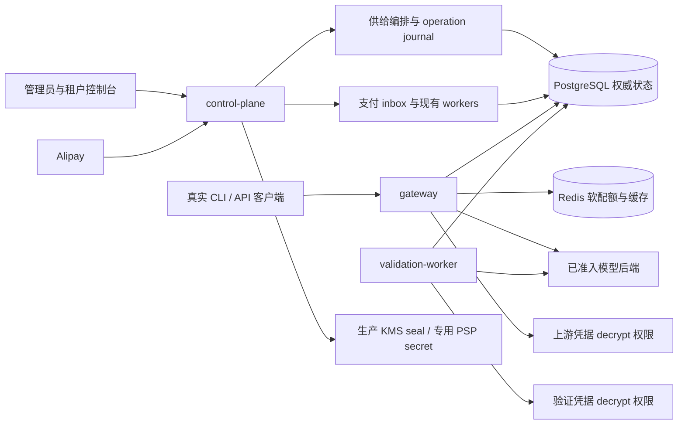

# 可运营多租户模型 API 平台：P0 技术方案

> 日期：2026-10-24。状态：设计待实施；本轮未执行测试、构建、格式检查或验收。
> 代码基线：model-router `44b0eb7`；只读对标基线：CLIProxyAPI `911f49c`、Sub2API `a3eb7ef`、New API `6549a17`。
> 本文中的“拟新增”接口、环境变量、表和状态均是设计，不表示当前产品已经提供。
> 任务状态只使用：待开发、待验收、外部证据阻塞；已有代码不自动等于运营验收完成。

## 1. 目标、范围与交付边界

目标是让一个全新租户通过正式入口获得可授权、可计费、可撤销的模型供给，完成真实收款和退款，并在受控负载、故障和恢复后保持资金及请求证据一致。
以三个主线收口：A 标准供给与协议工作流；B 单 PSP 标准收款退款；C 托管性能、恢复和生产运维验收。
继续采用模块化单体，同一代码库按 control-plane、gateway、validation-worker 角色部署；支付与退款 worker 复用当前编排，不拆新微服务。
复用 tenant/project/Key、钱包、套餐、价格、供给池、商业策略、OAuth、账户刷新与已有恢复机制。
不扩展营销、插件市场、白标、多 PSP 路由、实时汇率、全新账户体系或无关多模态产品。

首发拟定 Alipay precreate + CNY，前提是获得实际商户配置和验收账户；当前没有商户证据不等于已经具备收款条件。
可先用经过证明的非 Codex text/function 供给进行选定范围演示与运营验收。
这不会移除完整 P0 中 Codex compact、WS、remote history 与可信计费上界的任务。

| 里程碑 | 可作出的声明 | 必须满足 | 当前状态 |
|---|---|---|---|
| M1 选定供给演示 | 新租户正式入口完成指定模型请求 | A 正式 provision、指定协议工作流、明示限制 | 待开发/待验收 |
| M2 可收费运营 GO | 经批准的供给、币种、商户范围可收费 | M1 + B + C 性能/恢复 + 生产 KMS/同步持久恢复 + 发布候选必需 CI + 运营签收 | 待开发/待验收/外部证据阻塞 |
| M3 全 P0 完成 | 本方案关键能力全部收口 | M2 + 完整协议矩阵 + Codex 外部契约与真实工作流证据 | 外部证据阻塞，并有待开发项 |

M2 必须公示供给与工作流 allowlist，不能宣传已完整对齐 Codex compact/WS。
不能通过缩小全 P0 的定义，把 M1 或 M2 改称 M3。

## 2. 当前基线与六个真实缺口

以下锚点相对仓库根目录；行号定位本次基线附近实现，后续变更应同步记录新 revision。
对标关注 CLIProxyAPI 的 provider/协议工作流、Sub2API 的运营供给闭环、New API 的通道/价格/支付运营闭环；不按页面或 provider 数量机械复制。

| 缺口 | 当前实现与源锚点 | P0 收口 |
|---|---|---|
| G1 新租户平台权益没有正式供给闭环 | `src/saas/identity/service.ts:1156` 仅创建 tenant/default project/owner；`src/saas/keys/service.ts:541` 无权益报 `KEY_NO_ENTITLEMENT` | 窄 provisioning service 与管理员操作入口 |
| G2 协议可达性与 CLI 工作流证据不完整 | `src/protocol/bridge.ts:317` 缺 Chat↔Gemini、Responses↔Gemini 四方向；`src/saas/runtime/builtin-gateway-runtime.ts:595` 默认拒绝单 native 供给跨协议，Kimi/OpenAI 为例外 | 按 operation/protocol pair/workflow profile 开放，直接桥与真实 CLI 证据 |
| G3 Codex 计费边界不能证明 | `src/saas/runtime/builtin-usage-bounds.ts:149`、`:174` 与 runtime `:713` 明确 unavailable | 可信上界契约及后端证据；缺证继续拒绝 |
| G4 PSP 代码存在但正式装配和收银台未闭合 | 四个 provider 已有；CLI `:407` 只处理环境，`src/server/managed-saas.ts:476`、`:2669`、`:2909` 需要 payments/refundAdapter 装配；`saas-wallet.tsx:691` 仍为文本 | 单 Alipay 配置装配、二维码、轮询、退款状态 |
| G5 商户版本与历史单生命周期未闭合 | orders/refunds 有 provider_key/merchant_id，当前 singleton 会按当前 merchant 拒绝历史单 | immutable binding、历史 verifier/adapter 与单队列分派 |
| G6 SaaS 性能与收费生产恢复未验收 | 已有 Redis 配额/异步日志；短诊断 overhead 797.59/207.23ms 仍超过 30/10ms；软件 KMS pilot-only | 保留原 R9、正式供给首请求、故障不变量、生产 KMS 与异地恢复回执 |

`src/saas/plans/service.ts:1784`、`:2047` 的 project entitlement INSERT 是 BYOK 路径。
平台供给示例来自 `verify-commercial-kimi.ts:793`、`:796` 的 seed，不是新租户正式开户验收。
平台 catalog 主要负责读取；`src/saas/supply/service.ts:2500` 已有 grant，要求 profile active。
`src/saas/gateway/route-config-service.ts:348`、`commercial-metering-policy-service.ts:833` 与价格/capacity service 都应复用。
不能把上述能力描述为现成的单一 CLI 自动开通流程，也不能全部重建。

### 关键能力对齐映射

下表引用上述固定 revision 的参考源码能力，不构成对方线上可用性或性能验收声明。

| 参考源码与能力 | 本项目任务 | 对齐出口与边界 |
|---|---|---|
| CLIProxyAPI [账号池调度](/Users/lex/play/CLIProxyAPI/sdk/cliproxy/service_config.go:65)、[生产自动刷新启动](/Users/lex/play/CLIProxyAPI/sdk/cliproxy/service_lifecycle.go:102) | P01/P03，复用既有 OAuth/sink/refresh | 首发 pool 正式开户与可用性；不承诺复制 RR/WRR/fill-first/session affinity 全部策略或所有 provider，不扩新策略工程 |
| CLIProxyAPI [CLI/Responses WS 路由](/Users/lex/play/CLIProxyAPI/internal/api/server_routes.go:72)、[Vertex compact 限制](/Users/lex/play/CLIProxyAPI/internal/runtime/executor/gemini_vertex_executor.go:269) | P04/P05 | route 存在不等于所有 provider 通用或可信计费；该 executor 明确不支持 compact，Codex 缺证继续拒绝 |
| Sub2API [支付路由](/Users/lex/play/sub2api/backend/internal/server/routes/payment.go:32)、[余额/套餐履约](/Users/lex/play/sub2api/backend/internal/service/payment_fulfillment.go:216) | P06–P08 | 对齐回调、余额或套餐履约和退款用户交互；限定单 Alipay/CNY 真实扫码、到账、退款，不以多 PSP 数量冒充闭环 |
| Sub2API [PG 备份实现](/Users/lex/play/sub2api/backend/internal/repository/backup_pg_dumper.go:35)、[备份操作界面](/Users/lex/play/sub2api/frontend/src/views/admin/BackupView.vue:860) | P10–P12 | 目标是实际恢复工作流；按钮或 pg_dump 成功不证明异地恢复、金融保证或 RPO |
| New API [多协议路由](/Users/lex/play/new-api/router/relay-router.go:78)、[统一预扣/结算/退款会话](/Users/lex/play/new-api/service/billing_session.go:47) | P04/P05/P07/P09/P10 | 对齐多协议、WS 逐事件准入与资金生命周期；复用现有财务，不重建，接口覆盖不代替真实 CLI 和计费上下界证据 |

不按 provider 或页面数量全量复制参考项目。

## 3. 架构与权威边界



PG 保持账本、余额/hold、累计 Key/计费组预算、派发证据、支付事实与 operation 权威。
Redis 已承担共享 RPM/TPM/并发软配额；异步日志是独立写入机制，约 5 秒成功 auth cache 是进程内缓存。
三者均为已有机制，不列为待重建功能，也不把日志或 auth cache 归为 Redis 持久性保证。
非金融 Redis 计数存在已接受的短暂丢失窗口，不能宣传其 RPO=0，也不能把资金安全建立在异步 Redis 上。
control-plane 只读取 PSP 专用 secret，不新增上游凭据 decrypt 权限；gateway 不接收支付密钥。
validation-worker 保持当前账户验证职责，不能因支付接入扩大其权限。

## 4. A 轨：正式平台供给入口

### 4.1 窄服务与最小 API（拟新增）

拟新增 `PlatformInferenceAccessProvisioningService`，只协调已有 catalog、pricing、pool、route、commercial policy、capacity services。
不建立 offer/recipe 市场，不重新定义价格和供给模型。
资源引用必须指向已有发布记录，附 expected versions；操作保存不可变请求摘要与资源快照。

```ts
// 拟新增 DTO，字段名在实现评审时冻结。
type ProvisionPlatformAccessInput = {
  operationKey: string;
  tenantId: string;
  projectId: string;
  catalogProductRef: string;
  poolRef: string;
  customerPriceVersionRef: string;
  meteringPolicyVersionRef: string;
  capacityVersionRef: string;
  allowedModels: string[];
  expectedProjectAuthzVersion: number;
};
```

DTO 不要求新 profile 尚未生成的 routeConfigVersionRef；operation 调用已有 route 服务创建该 profile 的配置，持久化生成的 route version，并在激活前核验。
所需路由输入使用现有服务契约及已发布策略，不引入泛化模板平台。

拟新增管理员 API：`POST /api/platform/projects/:projectId/platform-access-operations`。
拟新增查询 API：`GET /api/platform/platform-access-operations/:operationId`。
拟新增禁用 API：`POST /api/platform/projects/:projectId/platform-access/disable`，携带 expected entitlement/authz version 和理由。
具体挂载前缀复用现有 platform admin router；必须使用现有管理员鉴权、CSRF 与审计链。
POST 返回 operationId、阶段、已创建资源 refs、可重试错误码，不返回凭据。
同 operationKey + 相同请求摘要返回原操作；不同摘要返回冲突。
project/tenant 跨界、未发布价格、币种不一致、能力不兼容和过期证据必须在创建前拒绝。

### 4.2 持久阶段与失败恢复

拟新增 operation journal，阶段可为 `accepted/assembling/recheck/activating/completed/failed`。
这不是 entitlement status；现有 schema 005 只有 `active/disabled`，不得把 pending/prepared 塞入权益状态。
operation 保存 actor、request hash、资源 ID、expected versions、阶段输出、重试信息和 ownership。
每阶段使用确定的资源 ID 或持久映射及幂等键，操作重入不能重复 grant 或重复创建权益。
已有 services 各自提交事务，整个编排不是单一 PG 原子事务。

1. 锁定项目授权范围，检查无 active 平台权益；已有 active 权益返回版本冲突，走独立显式替换流程。
2. 预分配该 operation 独占的 profile/entitlement ID；在一个短事务中先创建新 active profile，再创建 disabled entitlement（`disabled_at` 有值），同时保存 operation 阶段/资源关联并追加审计。schema 005 的即时 FK 要求 profile 先存在。
3. active profile 只归本 operation 所有，disabled entitlement 尚不授权；不复用已有 active profile 放宽旧 Key。
4. 调用已有 pool grant、route、policy、价格与 capacity 服务，逐步记录结果。
5. 失败写 journal，不自动删除不属本 operation 的资源，不撤销其他操作的 grant。
6. 查询后可按阶段幂等续做；权限或版本变化时停在 failed，要求重新确认资源版本。
7. 最终重验 tenant/project 权限、供给健康、能力、价格版本、币种和容量，获取现有授权锁。
8. 在单一 PG 事务中激活 entitlement、清除 disabled_at、追加审计并将 operation 标记 completed。

profile 与 entitlement 创建/变更必须补齐现有审计惯例。
激活事务与并发 disable/revoke 使用一致锁顺序；失去权限或 expected version 不符时不得完成。
不自动发 Key、不自动充值；Key 继续由现有明确入口创建，余额通过现有钱包流程提供。
禁用复用授权版本失效机制，覆盖约 5 秒 auth cache 的既有边界；验收记录实际撤销生效窗口。
显式替换旧权益必须独立授权、展示影响 Key 和模型集合，本轮初版可拒绝替换并保留后续任务。

### 4.3 协议准入与 CLI 工作流

provider adapter、OAuth、sink、refresh、WS、compact 已有接线，P0 补齐准入及证据，不另造 provider 框架。
复用 capability/readiness，索引维度必须是 operation + client protocol + upstream protocol + workflow profile。
先开放已有并通过证据的 pair，再实现四个直接桥；禁止随意串两段有损 SSE 转换充当直接支持。
遇到不支持的供应商特有字段，应返回明确错误及字段说明，不静默删除 thinking、tool 或 continuation 语义。

| 工作流 | P0 实现/证明内容 | 出口与状态 |
|---|---|---|
| Chat↔Gemini | 请求、工具、usage、流式增量、错误和取消的直接转换 | 待开发/待验收 |
| Responses↔Gemini | response/item/tool IDs、状态、usage 和流式事件直接映射 | 待开发/待验收 |
| 现有 Anthropic/OpenAI/Responses pairs | 审视已有 capability 与 runtime 默认拒绝；仅开放有证据的路径 | 待开发/待验收 |
| 真实 CLI 两轮工具调用 | 实际 CLI 版本、精确模型、两轮 tool result、thinking 保真/限制、取消、重连、usage | 待验收 |
| Codex compact/WS/remote history | endpoint/model/backend revision、完整 billable input 和 reasoning output 上界 | 外部证据阻塞 |

每条矩阵记录 CLI 名称/版本、operation、pair、模型 revision、输入类别、流式/非流式、证据 ID 和限制。
“HTTP 200”不足以证明两轮工具或 compact 工作流成功；需保留脱敏事件序列和最终账务快照。
重连不能默认重放已派发请求；沿用现有幂等/unknown 语义，按操作契约处理。

### 4.4 Codex 可信计费上界

`max_output_tokens` 被保留不证明后端强制执行该上限。
opaque/encrypted compact 与 remote history 的完整 billable 输入、reasoning 输出必须有可信上界。
拟新增 trusted bound profile，作为现有 capabilities 的受信证据扩展，绑定 endpoint、model、backend revision、操作和有效期。
profile 必须引用实际后端契约、可验证限制及维护责任；operator JSON 单方断言不能成为可信上界。
实际用量超过预留或后端 revision 改变时停止新 admission，保留原派发与结算证据，进入人工对账。
没有契约或可验证证据时继续 `unavailable`，不得用虚构模型 context 或经验倍率解锁。
外部任务是取得供应商 enforcement/计量口径说明并完成受控真实请求，不是写配置绕过拒绝。

## 5. B 轨：单 PSP 收款与退款

### 5.1 首发装配与配置（拟新增）

拟新增 `MODEL_ROUTER_SAAS_PAYMENTS_CONFIG_FILE`，仅 control-plane 读取。
配置 schema v1 的 provider 枚举只允许 Alipay；现有 Stripe/WxPay/EasyPay 代码继续保持明确未启用状态。
首发使用 Alipay precreate 返回的 QR 内容；当前联合类型适合该路径。
Stripe 当前把 client_secret 放入 qr，且没有 Stripe.js collector，因此不能作为首发默认方案。

配置包含 schemaVersion、bindingId、provider、merchant public identity、currency、状态和 secretRef。
状态为 `disabled/draining/enabled`：enabled 接新单；draining 拒绝新单但继续历史 callback/query/fulfill/refund。
disabled 不得无条件丢弃已存在支付事实；在历史义务未清理前应保持 draining，紧急停用需人工对账。
公有摘要和配置 hash 可以持久化；secret 只保存引用，不写配置导出、日志或 Git。
PSP 私钥/证书由 systemd credentials 或 compose 只读 secret mount 提供；失败启动应明确指出缺少引用，不打印秘密。
现有 CLI/environment 装配处必须把 provider 与 refundAdapter 实际注入 `managed-saas`。

### 5.2 商户 binding 与版本

拟新增 append-only merchant binding/version；同 provider 可有 active 新单 binding 和多个 draining 历史 binding。
merchant 身份包括 app/seller/merchant 标识及环境，创建后不可修改；切商户创建新 binding。
多 control-plane 副本的新单 active binding 由 PG 按 purpose/currency 作用域的 version/CAS 指针决定，复用已有 versioned platform setting/注册元数据。
JSON 中 activeMerchantVersion 只表达部署期望，不能由副本本地配置决定新单商户。
切换先确认相关副本都可解析新 binding 与历史 binding，再以 expectedVersion 执行带审计的 CAS 激活。
create-order 先复用 `findOrderByClientRequest` 按 tenant + 原业务幂等身份查既有订单及原 binding，再处理真正新单。
已有记录必须按原幂等指纹比较 payload，匹配则返回原单，不因商户切换重新计算指纹或找不到原单；不匹配返回冲突。
仅真正新单在同一事务读取并绑定 PG 权威 active generation；并发创建由既有唯一约束/幂等重读收口。
副本缺少该 version 时拒绝新单并报告 readiness，历史 callback/refund 继续。
订单、BYOK plan order、payment inbox、refund 持久化不可变 `binding_id`。
退款继承原单 binding，禁止使用新商户密钥退款旧商户订单。
私钥轮换独立建允许的 credential version 关系，保留凭据生效期、证书/公钥与审计，不等同于商户迁移。

callback path 仅定位候选 verifier，不构成身份事实。
通过验签后核对 app、seller、订单、金额、币种等真事实，再写入现有 inbox。
保持原去重身份，不因新 callback 入口或 binding 版本扩大可重放次数。
原单关联、provider 事件 ID/既有业务唯一约束继续防重复，验签成功也不能重复入账。
单队列 worker claim 后按原单 binding 选择 adapter，不为每个 merchant 启动一个抢全表的旧 worker。
query、fulfill、refund 与 reconciliation 同样按 immutable binding 查 adapter。
旧行只在唯一可证时回填；歧义进入明确 reconciliation 状态，禁止该商户启用新单直到解决。
不得凭“当前配置看起来一样”猜测历史 binding。

### 5.3 资金与币种不变量

钱包、套餐、PSP 与 customer price 必须同币种；CNY 收款不得默记 USD。
复用既有 append-only 发布 CNY 价格/计划，不引入实时 FX，不虚构一组新价格通过检查。
金额在服务内使用 BigInt，跨 JSON 边界用最小单位十进制字符串；禁止浮点乘除与前端换算权威金额。
BYOK customerPriceVersion 为 null，模型调用不扣平台 Token 钱包；BYOK 套餐支付仍遵守其订单币种。
浏览器成功页面不入账；以验签 PSP 事实及既有服务条件驱动账本变化。
支付重复、乱序、查询超时与提交 ACK 丢失只查原单，未知结果不能创建替代金融请求。
所有金融变化与审计在同 PG 事务提交；hold 和 unknown 保留到有证据或人工裁决。
退款上限、并发退款、重复 PSP 回执和到账后的套餐权益影响复用现有 refunds 机制。

### 5.4 收银台交付

钱包和套餐入口都需要本地 QR 渲染，不能继续只展示 textarea 或文本。
QR 内容必须来自服务端订单结果，浏览器不接触 PSP secret；二维码组件依赖在实现评审时选定。
页面显示币种、最小单位格式化金额、订单号、过期时间与明确状态。
复用已有客户订单查询接口轮询，包含退避、后台暂停、过期停止和恢复查询。
创建响应丢失且浏览器没有 orderId 时，不能调用只认 orderId 的现有 GET 猜测原单。
客户端使用原 POST + 原 idempotency-key + 原 payload 重入，服务端通过 `findOrderByClientRequest` 返回原单与原 binding，再按 orderId 查询。
明确关闭/过期后才允许用户显式创建新业务请求及新幂等键；不能因切商户或超时自动换键。
退款展示 submitted/processing/succeeded/failed/unknown 的现有语义映射及人工处理中提示。
只有服务端确认入账才刷新余额与权益；前端状态不得成为支付完成证据。

## 6. C 轨：性能、过载和故障恢复

### 6.1 先验证最小正式路径，再扩展压力

先用 A 正式 provision 的全新租户，通过非 seed 正式 admin/customer 入口及实际 builtin 完成首笔请求，禁止 direct SQL 代替开户。
canonical R9 使用标准 CLI 与 bench runtime/mock 固定夹具，功能及财务约束使用真 PG；它不是 builtin 真实 provider 验收。
标准开户/实际客户端工作流与 canonical R9 是两个独立 gate，分别保存证据。
最新短诊断 797.59ms p99 overhead、207.23ms TTFB overhead 仍未满足 30/10ms 原门槛。
self-hosted 真实 Kimi 交替请求与直连接近，只说明该次路径；不能代替 SaaS 托管验收。
已实现的 Redis 共享配额、异步日志和 auth cache 作为基线，不重复立项。

1. 专用 runner 固定 hardware、依赖版本、payload、build、durability 配置与供给，记录持续 CPU/load/IO。
2. 原受控 serial 四腿各 100 样本对照先执行；保留原 p99 overhead ≤30ms、TTFB overhead ≤10ms，不更换 percentile 算法消除尾部。
3. 同 binary、同资源比较 cap 关闭与 cap=8 的 c=200、60 秒 A/B；关闭用环境变量 unset/empty，禁止设为字面量 off；8 仅候选，不能预设为最终容量。
4. 前项有有效结论后执行原完整 R9：SSE 10 分钟、零意外 5xx/transport、1→3 实例 ratio ≥2.7、账户精度。
5. 每个主要负载至少保留 100 个成功样本，作为拟新增样本充分性门槛；不足记不充分，不能宣告通过。

分开报告成功 200 的 accepted latency、200 successful rps 与 429 数量/比例；保留失败原样本。
cap=8 不能仅通过拒绝大部分请求改善表面延迟；必须解释成功吞吐和拒绝率的业务容量影响。
禁止全 429 伪通过、扩大 pool/timeout 绕门槛、关闭 fsync/synchronous_commit 或删除失败样本。
单资源队列不并行 build 与 PG 压测；发现竞争、热降频或依赖异常则标记 invalid 并保留原因。
不能根据单个 Load 值直接归因；诊断结果与 acceptance 结论分别记录。

### 6.2 最小可解释 trace

同 request trace 至少记录 pool checkout wait、query/transaction、upstream send、首字节、EOF、settle。
pool checkout 必须由客户端 acquire/release 测量，PG wait event 不能冒充连接池等待。
阶段采用不重叠区间或明确 exclusive 计算，不能叠加 inclusive phase 制造总耗时。
流式 EOF 与金融 settle 分开；客户端已收到 EOF 不能证明结算完成。
仅补足定位首个真实瓶颈所需观测，优化按证据逐项实施，不先扩大架构。

### 6.3 恢复矩阵与最终不变量

| 故障注入设计 | 必须观测 | 最终不变量 |
|---|---|---|
| Redis 重启/旧 snapshot 恢复 | 准入、计数恢复窗口、重复 lease 处理 | PG 金融和累计预算不回退；软配额 RPO 单列 |
| PG 停止/commit ACK 丢失及主故障域丢失 | 原请求查询、unknown、同步副本 WAL 持久位置与恢复记录 | 按 §6.4 恢复最后已确认金融 commit；不重复扣款或派发，缺证禁止自动重开 |
| 支付/退款 worker 进程死亡 | claim/lease 超时、原单恢复 | 一个 PSP 事实最多一次账本效果 |
| PSP 重复/乱序/历史商户回调 | verifier、binding、inbox 去重、query | 原商户完成原单；退款累计不超过可退金额 |
| gateway cancel/SSE EOF 后故障 | 派发、usage、hold、settle | 不因断流重复派发；未知 hold 保留 |
| rolling drain | 新请求拒绝、在途流与结算退出 | 无意外截流；lease 和结算有可追踪归宿 |
| tenant/Key/entitlement 撤销 | 缓存失效、并发 admission、版本 | 新授权按撤销契约生效，无越权供给 |
| 长期 unknown 人工处理 | 操作权限、依据、双向审计 | 无自动释放/重派，人工结果可追溯 |

每个场景输出 before/after wallet、ledger、hold、lease 和 dispatch/inbox 快照及差异说明。
复用现有 recovery，不以“进程重新启动成功”代替资金与租约收敛证明。
人工处理必须明确操作者、证据与决议，秘密和完整用户 payload 不进入 Git。

### 6.4 标准部署与收费前置

`deploy/compose/docker-compose.yml:77` 仍配置 Redis no AOF；compose README 的 cache-only 注释与最新软配额用途冲突。
C 轨修复为每秒 AOF 与 noeviction，并更新持久卷、恢复和容量告警说明；这仍不承诺软配额零丢失。
金融 PG 保持 durability，生产 KMS、角色 IAM、凭据轮换和告警复用现有 runbook。
`deploy/README.md:299` 明确软件 KMS 为 pilot-only，不能用于收费 production。
收费生产选定策略：PG 的关键金融提交由独立故障域的同步持久副本确认，钱包/ledger、hold、dispatch/unknown 及其关联证据均须覆盖。
部署明确配置同步复制目标与提交等待语义，例如 `synchronous_standby_names` 配合 `synchronous_commit=on` 等待同步副本 WAL flush；不得静默降级为异步后继续确认金融提交。
同步副本不可用时金融提交等待或按明确超时进入 unknown，不自动改成 local/off；恢复仍查原请求。
收费 GO 必须有独立同步持久证据、提交确认边界和故障切换 fencing，并实际演练恢复包含最后已确认金融 commit 的 WAL。
没有这些证据时 C2 阻塞，不能以“PG durability 已开启”或原则性的零丢失声明替代机制与演练。
PSP 无法重建模型扣费、hold、dispatch 和 unknown；同 PG 内的账本也可能随故障一起丢失，不能仅靠 PSP 对账宣称恢复。
若同步证据丢失或无法证明恢复边界，禁止自动重开收费；保持未知状态，由人工依据独立持久证据裁决。
归档/PITR 与真实异地 backup 恢复另作灾难恢复层，不能替代同步金融提交保证。
RPO ≤15 分钟只作为非金融或非收费 pilot 的初始设计目标；RTO ≤60 分钟、保留 30 天亦待实际演练确认。
非金融 quota 的短暂计数丢失窗口独立记录，不冒充金融 RPO 或归档恢复保证。
收费 GO 还必须取得生产 KMS/IAM、异地 backup/PITR 回执、告警及运营签收。
发布候选 commit 必须通过仓库正式必需 CI 门槛，并绑定确切 revision/build；历史绿色结果不能替代。本轮未运行 CI。

## 7. 数据迁移与回滚设计

所有 schema 变化只追加当前唯一 `SAAS_MIGRATIONS` 注册链的下一个未占编号；实施时读取 head，不能预占或修改旧迁移。
拟新增 platform access operation/journal，保存 ownership、幂等摘要、版本、阶段与审计关联。
拟新增 merchant binding/version、credential version 引用关系与不可变公有配置摘要。
拟向 orders、BYOK plan orders、inbox、refunds 增加 binding 引用；准确表名与约束以现有 schema 为准。
迁移先允许旧行空值，执行可审计的唯一性回填，隔离歧义；再按业务范围加约束和启用门槛。
不在迁移中补造金融交易、默认商户或价格，不以 direct SQL 代替正式业务操作。
operation 完成与 entitlement 激活约束必须防止 completed 但无有效权益的半状态。
预发布检查包含新版写入/旧版读兼容性、历史 callback 与并发 worker 的 binding 选择。

回滚以禁用新入口、新 merchant draining、供给 disable 与二进制兼容回退为主。
保留历史 binding、订单、账本、inbox 和 journal，不做删除金融历史的 down migration。
激活前失败的 operation 保留可查询状态；只清理由自身拥有且未被其他业务引用的资源。
一旦新订单写入 binding，新版历史处理能力必须保留，不能切回无法识别 binding 的旧 worker。

## 8. 文件级实施任务、依赖与责任

责任模型：Astra 负责设计审查与契约判断；Sol 实现；Luna 在用户允许执行后负责未来验证与证据整理。
本轮没有任何任务通过新测试；“首个验证”列仅是未来验证设计。

| ID | 文件/模块责任 | 依赖 | 首个未来验证与出口 | 状态 |
|---|---|---|---|---|
| P01 | 拟新增 `src/saas/supply/platform-inference-access-provisioning.ts`；identity/keys 仅必要接线 | 无 | 新项目正式开户；同幂等键同结果、冲突版本失败 | 待开发 |
| P02 | 同一 schema writer 的两批顺序迁移：P02a 开户 operation/profile/entitlement 审计；P02b merchant binding/CAS/引用；仅追加唯一注册链 | P02a：P01 契约；P02b：P06/P07 接口契约冻结后追加 | P02a：即时 FK 顺序、阶段续做与最终事务一致；P02b：商户版本/CAS/不可变引用 | 待开发 |
| P03 | 现有 platform admin router/UI 的 supply 操作与状态查询 | P01/P02a | 管理员操作→手工创建 Key→首个请求，无 seed | 待开发 |
| P04 | `src/protocol/bridge.ts` 及直接桥；runtime capability/readiness | P01 契约 | 四方向及已开放 pair 两轮工具/SSE/cancel/usage | 待开发 |
| P05 | `builtin-usage-bounds.ts`、Codex/runtime capabilities 的可信 profile | 外部后端契约 | 精确 endpoint/revision 上界证明；缺证仍 unavailable | 外部证据阻塞 |
| P06 | payments 部署 parser/凭据 loader、CLI、`src/cli/saas-doctor.ts` 与 `src/server/managed-saas.ts` 装配 | 无 | Alipay 启用/排空、安全错误、缺 secret fail closed、角色隔离及 readiness | 待开发 |
| P07 | `src/saas/payments/` binding resolver、http/workers/refunds；plans 关联 | 实现依赖 P02b/P06；接口契约可先并行冻结 | 丢响应原 POST 重入返回原 binding；历史回调/退款与重复事件仅一次入账 | 待开发 |
| P08 | `saas-wallet.tsx`、套餐收银台与现有查询组件 | P06/P07 | QR、过期、原单重查、退款 unknown 和到账刷新 | 待开发 |
| P09 | gateway PG client/trace 与已有 ops bench 驱动 | P03 | 正式首请求→serial 四腿→cap A/B；保留原门槛 | 待开发/待验收 |
| P10 | 既有 recovery/ops 场景与私有证据模板 | P07/P09 | 故障矩阵每项输出资金/hold/lease 不变量 | 待验收 |
| P11 | `deploy/compose/`、systemd 与既有 KMS/backup runbook | P06/P10 | AOF/noeviction、生产 KMS、独立同步持久金融恢复及异地 PITR 回执 | 待开发/外部证据阻塞 |
| P12 | 本方案与开发进度文档的 gate 记录 | P01–P11 | M1/M2/M3 分开签收，候选 commit 必需 CI、完整 R9 与未决证据可追溯 | 待验收 |

可并行四 lane：A 供给 P01/P03；B 协议 P04/P05；C 支付 P06/P07/P08；D 性能/运维 P09/P10/P11。
迁移注册链、`managed-saas.ts`、CLI、runtime 主文件、共享 DTO 和进度文档必须单 writer。
P02 仍为一个主任务，由同一 schema writer 分 P02a/P02b 两批顺序追加，不指定迁移号；lane 不各自抢号。
P02a 依赖 P01 契约先行，P03 只等待开户批；P02b 在 P06/P07 接口契约冻结后后续追加，P07 实现再依赖 P02b/P06。
契约冻结可并行，不形成 P02 与 P07 实现的依赖循环，支付设计不阻塞最小新客路径。
跨 lane 只提交明确接口需求，修改共享文件由其 owner 执行；不回滚他人改动。
建议先交付 P01/P02a/P03 的最小路径，再解锁支付/性能集成，避免同时扩大待诊断面。

## 9. 验收 gate 与证据要求

| Gate | 验收范围 | 通过证据 | 阻塞时处理 |
|---|---|---|---|
| A0 | 新租户正式平台供给 | 管理入口 operation→有效权益→Key→指定请求，含禁用/版本冲突 | 不允许 seed 替代 |
| A1 | 指定 CLI 协议工作流 | 两轮工具、thinking 限制、取消/重连、usage 与模型 revision | pair 继续拒绝 |
| A2 | Codex 完整能力 | 后端 enforcement、opaque/remote input、reasoning 上界与真实 compact/WS | unavailable；M3 阻塞 |
| B0 | 单 Alipay/CNY | 实际 precreate、丢响应原 POST 重入、回调、到账、查询、全/部分退款及乱序 | M2 阻塞 |
| B1 | 商户/密钥历史 | 切 merchant/轮换、历史单回调退款、歧义回填隔离 | 保留 draining，禁止新启用 |
| C0 | SaaS 性能与过载 | 有效 serial、cap A/B、完整 R9、成功样本/200rps/429 分列 | 不改门槛，定位首失败 |
| C1 | 故障恢复 | 每项故障最终金融/hold/lease 快照与人工 unknown 记录 | M2 阻塞 |
| C2 | 收费生产运维 | 生产 KMS/IAM、最后已确认金融 commit 的独立同步持久恢复演练、异地 backup/PITR、候选 commit 必需 CI、告警与运营签收 | 缺任一证据仅 pilot，丢金融证据禁止自动重开 |

证据区分源码/设计、确定性 fixture、mock 压测、真实 CLI、真实 PSP、真实生产恢复。
每份未来报告记录 git/build、dirty 状态、环境、参数、完整结果与失败；私有证据使用受控存储引用及 hash。
M1 至少 A0+A1 指定范围；M2 还需要 B0/B1/C0/C1/C2；M3 额外需要 A2 和完整 P0 协议矩阵。
旧报告只能作为历史基线，不能作为本轮实现通过证明。

## 10. 实施前待决问题与外部前置

1. 哪个已发布非 Codex 产品/模型和真实 CLI 版本作为第一条正式 provision 演示？需绑定现有 pool/price/capacity refs。
2. Alipay 真实商户主体、CNY 钱包/计划发布、回调域名、验签材料与受控退款额度由谁提供？当前待外部配置。
3. 历史订单是否能唯一归属商户 binding？歧义清单必须先完成 reconciliation 决议。
4. Codex 精确 endpoint/backend revision 能否提供输出 enforcement 和 compact/remote history 计量契约？缺证阻塞 A2。
5. 专用性能 runner、同版本依赖和压测资源窗口何时可用？资源污染不得据此修改 R9 门槛。
6. 生产 KMS/IAM、独立故障域同步 PG 副本、金融提交等待/fencing、异地备份及演练责任人是否落实？软件 KMS 和异步归档不能替代。
7. 金融 GO 必须演练最后已确认 commit 的独立持久恢复；15 分钟 RPO 仅非金融/非收费 pilot，RTO/保留目标待确认。
8. 发布候选 commit 的正式必需 CI 及确切 build 证据由谁收集？历史绿色不能替代，本轮未运行。

下一步从 P01/P02 最小契约和首个供给引用冻结开始；本方案不授权执行测试或生产变更。
